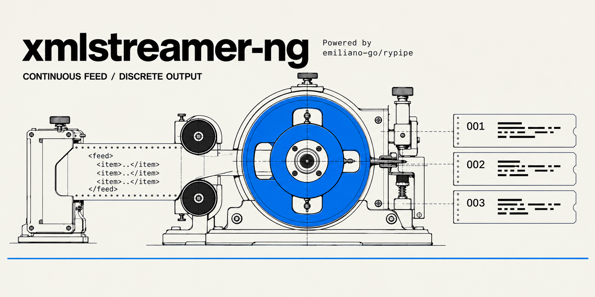

# xmlstreamer-ng

<p align="center">
  <a href="https://www.python.org/downloads/">
    
  </a>
  <a href="https://www.rust-lang.org/">
    
  </a>
  <a href="LICENSE">
    
  </a>
  <a href="https://github.com/emiliano-go/xmlstreamer-ng/actions/workflows/ci.yaml">
    
  </a>
  <a href="https://pypi.org/project/xmlstreamer-ng/">
    
  </a>
</p>

**Stream huge, messy XML feeds into Python records - without loading the entire document into memory or hiding partial failures.**

**xmlstreamer-ng** is a Python library designed for efficient, memory-friendly streaming and parsing of large XML feeds from various sources, including compressed formats. It supports decompression, character encoding detection, tag-based itemization, and optional item filtering, making it ideal for handling real-time XML data feeds, large datasets, and complex structured content.

## Origins

xmlstreamer-ng is based on [carlosplanchon/xmlstreamer](https://github.com/carlosplanchon/xmlstreamer), the original project by Carlos A. Planchón (MIT), and keeps its streaming, item-based approach to parsing large or malformed XML feeds. Its parsing engine is built on [emiliano-go/rypipe](https://github.com/emiliano-go/rypipe) ([rypipe-core](https://crates.io/crates/rypipe-core)).

## Why xmlstreamer-ng?

Large XML feeds retrieved from remote systems can be malformed, incorrectly encoded, or interrupted in transit. xmlstreamer-ng processes them incrementally and isolates failures when corruption is contained within an item, while reporting partial failures explicitly.

With a strict parser, one broken record invalidates the entire document. With an aggressive recovery parser, malformed input may be silently rewritten into data that was never actually there. xmlstreamer-ng is built for the space between those two behaviors:

- process large XML documents without loading them entirely into memory;
- deliver every intact item, before and after localized corruption;
- never repair damaged XML into records that were not in the feed (with one judgement call that cannot be made for you - markup that opens and never closes - left in your hands and documented below);
- expose partial failures explicitly instead of presenting incomplete processing as success.

It is intended for XML ingestion, archival processing, ETL and migration workflows where bounded memory, conservative recovery and explicit failure semantics matter.

### When not to use it

- If your XML is trusted, consistently well-formed and raw speed is the primary concern, `lxml.etree.iterparse` is the simpler, battle-tested tool - though on item-shaped feeds the benchmark below shows it no longer ahead.
- If your data lives in XML attributes (`<book id="123" year="1998"/>`), this library will not extract it: items are built from element text only.
- If your separator tag legitimately nests inside itself, that is outside this library's documented contract.

xmlstreamer-ng is for large or unreliable inputs where conservative recovery, bounded memory and explicit partial-failure semantics matter more than maximum parser throughput.

## Features

- **Streamed Data Parsing**: Parses XML data directly from HTTP, HTTPS, or FTP sources - or from a local file or any binary stream (`source=`) - without loading the entire file into memory.
- **GZIP Decompression Support**: Seamlessly handles GZIP-compressed XML feeds, including multi-member (concatenated) gzip.
- **Encoding Detection**: Automatically detects character encodings on both plain and GZIP streams (UTF-16, Latin-1, etc.) and transcodes them to UTF-8 on the fly. Valid UTF-8 input is never altered. Detection reads the head of the feed, so bytes that contradict it much later cannot be transcoded: those are replaced with `U+FFFD`, warned once per run and counted in the closing stats.
- **Customizable Item Tokenization**: Uses a byte-level tokenizer to isolate items and parses each item independently in the Rust engine. Separator tags inside comments, CDATA, processing instructions or DOCTYPE declarations are ignored, so markup can never open or close an item - nor invent one. Attribute values may contain `>` (only `<` and `&` are illegal there) without confusing the scan, and buffer or chunk sizes never change what comes out. One contract: the separator tag must not nest inside itself (no `<item>` containing another `<item>`). One knob for the one case with no universal answer, a section that never closes: `Sections(on_limit=...)` chooses between reading it as content past `max_size` (the default: bounded damage) and discarding it whatever follows (never a record, at the price of the rest of the feed).
- **Configurable Runtime and Buffering**: Includes configurable buffer sizes and runtime limits, allowing you to tailor performance to your application's needs. `buffer_size` is the initial read buffer, not a size limit: items larger than the buffer are still parsed (the buffer grows as needed to fit the current item). `max_running_time` is a per-run budget measured on a monotonic clock, so an NTP step or a daylight saving shift can never cut a run short. It covers the whole run, acquisition included: the download, the encoding sample and the scan all check it. What it cannot do is interrupt a read or a parse already in flight, so a run can overshoot by one read (up to 64 KiB of network, however long that takes to arrive) or by one item's parse.
- **Download Timeouts**: `Transport(timeout=(connect, read))` in seconds, default `(30, 300)`. The read timeout is the maximum silence between bytes on the streamed download, not a total duration, so huge-but-flowing feeds are never cut while stalled connections fail fast. Pass `Transport(timeout=None)` to disable.
- **Authentication and Proxies**: Basic, Digest, Bearer and API-key-header authentication, plus requests-style proxy support.
- **Two Download Modes**: spool to a temporary file (default) or stream straight from the network, with explicit error semantics (`FeedInterruptedError`) and deterministic resource release via `close()` / context manager.
- **Flexible Filtering**: pass any callable as `item_filter`; it receives each flat item dict and its truthy/falsy return keeps or drops the item. Note that items are built from element text only: XML attributes (like `id` in `<book id="123">`) are not extracted.
- **Typed**: ships PEP 561 type hints (`py.typed`), so type checkers and editors see the whole public API.
- **Property-tested**: beyond the example-based suite, generative tests (Hypothesis) verify the core invariants over thousands of generated feeds - item isolation under corruption, chunking invariance, and crash-freedom on arbitrary bytes.

## Installation

Install with uv or pip:

```bash
uv add xmlstreamer-ng   # or: pip install xmlstreamer-ng
```

Requires Python 3.11 or newer. The parsing engine is a Rust extension
(built on [rypipe-core](https://crates.io/crates/rypipe-core)): prebuilt wheels
need no toolchain, but building from source needs a Rust toolchain (1.78+).

## Usage

```python
from xmlstreamer_ng import StreamInterpreter

interpreter = StreamInterpreter(
    url="https://example.com/large-feed.xml",
    separator_tag="item",
)

for item in interpreter:
    print(item)  # each item is a flat {path: text} dict
```

That is the whole program: gzip, character encodings and malformed items are handled by default, and the feed is never loaded whole into memory. Tuning knobs (`buffer_size`, `max_running_time`, `Transport`, filters, nested output) exist when you need them and are documented below.

The interpreter is reusable configuration; iterating it opens a run (`FeedRun`) that owns one pass over the feed. Runs are independent, so nested loops and retries over the same interpreter are ordinary code, and the interpreter answers for the last one through `last_run` and the `stats_*` properties.

### Columnar and parallel ingestion (rypipe adapter)

For local files, the same Rust engine also exposes a columnar/parallel API
built on [rypipe](https://github.com/emiliano-go/rypipe), producing Arrow
tables:

```python
from xmlstreamer_ng import XmlSource, CastTypes, FilterRows, col

table = XmlSource("feed.xml", separator_tag="item").to_arrow()

df = (
    XmlSource("feed.xml", separator_tag="item", schema=["id", "title"])
    | CastTypes({"id": int})
    | FilterRows(col("title").is_not_null())
).to_pandas()

for batch in XmlSource("big.xml", separator_tag="item").iter_record_batches(threads=8):
    writer.write_batch(batch)
```

`XmlSource` follows the rypipe adapter contract (`schema`, `field_types`,
`drop_fields`, `filter`, `engine`/`threads`, `memory`), and importing
`xmlstreamer_ng` registers it so `rypipe.read("feed.xml", separator_tag="item")`
works too.

Drop semantics are the streaming path's: a malformed item is skipped, but
the skip is logged at `WARNING` on the `xmlstreamer_ng` logger and counted.
The same holds for a comment, CDATA section, or processing instruction that
never closes (the rest of the chunk is discarded and the warning says how
many bytes) and for closing delimiters with junk such as `</item junk>`,
which still end the row but are counted as malformed. After a read finishes,
`_xmlstreamer.last_read_diagnostics()` returns the counters (a clean read
returns `None`); `iter_xml_batches_par` reports when its iterator is
exhausted.

Local data uses the same pipeline: pass `source=` instead of `url=` - a
filesystem path or any binary file-like object (`io.BytesIO(...)` in a unit
test, `sys.stdin.buffer` in a pipe). Gzip and encoding detection still apply,
and no temporary file is involved. A path can be iterated again like a URL
(each run reopens it); a file-like object is consumed by its first run, and a
second run raises instead of yielding zero items.

## Command line

The package doubles as a diagnostic tool: stream any feed to JSON Lines without writing code.

```bash
uvx xmlstreamer-ng https://example.com/large-feed.xml --tag item --limit 5
```

The positional argument is a URL, a local file path, or `-` for stdin, so the same tool replays a saved feed and composes in shell pipelines:

```bash
xmlstreamer-ng saved-feed.xml --tag item
curl -s https://example.com/large-feed.xml | xmlstreamer-ng - --tag item
```

One JSON object per line on stdout, ready to pipe into `jq`, a file, or whatever sits downstream. In [Nushell](https://www.nushell.sh/) that stream becomes a native table in one pipeline - type the fields, filter, group and export from there (values arrive as strings, so promote what you need):

```nushell
xmlstreamer-ng https://example.com/large-feed.xml --tag item
| from json --objects
| update price {|r| $r.price | into float}
| where price < 10
| to csv
```

The useful flags mirror the API: `--mode stream` (no temp file), `--nested` (nested dicts), `--raw` (each item's bytes instead of JSON; add `--print0` for NUL-delimited framing), `--limit N` (sample cheaply and release the source), `--max-seconds S` (time budget) and `-v` (progress and stats on stderr). Errors exit non-zero with a one-line message, and a mid-feed cut in stream mode reports how many items were delivered before dying.

## Cookbook

[`COOKBOOK.md`](COOKBOOK.md) has task-oriented recipes: surviving mid-feed connection cuts without duplicating work, feeds bigger than RAM, cheap sampling, JSONL pipelines, production logging, processing many feeds in parallel, and more. Every snippet in it is extracted and executed by the test suite against a local feed server, so the recipes cannot drift from the real API.

## Performance

Honest numbers against the obvious alternatives. Everything comes from the
reproducible harness in [`benchmarks/`](benchmarks/README.md); one command
re-measures it on your machine:

```bash
uv run --group bench python benchmarks/bench_all.py    # one table, every engine
uv run --group bench python benchmarks/run_all.py
uv run --group bench python benchmarks/bench_rypipe.py --feed-mb 100
uv run --group bench python benchmarks/bench_scaling.py
# optional native ruler: quick-xml / simdxml / pugixml
benchmarks/native/build_native.sh
```

*Measured 2026-10-13 on a Ryzen 7 5800X, Python 3.14.8, xmlstreamer-ng 1.1.0,
xmlstreamer (original) 2.2.0, lxml 6.1.3, xmltodict 1.0.4, simdxml (Python) 0.3.0.
Absolute numbers track the machine; the ratios are stable across runs.*

**All engines, one feed (consolidated).** Every engine below reads the same
synthetic plain feed: 128 MiB, 953,250 items. Best of 3 rounds; peak RSS for
the Python engines is measured in a fresh subprocess, for the native counters
from the process rusage. Regenerate this table with
`python benchmarks/bench_all.py` (it skips the native rows with a note when
the binaries are not built):

| engine | items/s | MB/s | peak RSS MB | threads | API/notes |
|---|---|---|---|---|---|
| xmlstreamer-ng per-item | 273k | 36.7 | 76 | 1 | per-item dicts |
| XmlSource columnar | 1.2M | 156.3 | 301 | 1 | Arrow batches |
| XmlSource parallel (8 threads) | 6.2M | 835.5 | 275 | 8 | Arrow batches, 8 threads |
| XmlSource bounded parallel streaming | 5.2M | 703.3 | 197 | 8 | bounded batches, 8 threads |
| xmlstreamer (original) | 88k | 11.9 | 35 | 1 | per-item dicts |
| lxml iterparse | 528k | 70.9 | 22 | 1 | iterparse + clear() |
| stdlib ET iterparse | 284k | 38.2 | 20 | 1 | iterparse + root.clear() |
| xmltodict | 87k | 11.7 | 471 | 1 | whole-document dict |
| simdxml (Python) | 554k | 74.4 | 1063 | 1 | per-item dicts, whole-doc parse |
| simdxml parallel (Python) | 498k | 67.0 | 1062 | 16 | per-item dicts, parallel SIMD parse |
| quick-xml 0.37.5 | 3.3M | 444.0 | 251 | 1 | parse+count only, no data |
| simdxml 0.2.1 (git) | 1.6M | 210.2 | 722 | 1 | parse+count only, no data |
| pugixml 1.15 | 2.1M | 279.3 | 774 | 1 | parse+count only, no data |

*Measured 2026-10-13 on a Ryzen 7 5800X, Python 3.14.8, xmlstreamer-ng 1.1.0,
xmlstreamer (original) 2.2.0, lxml 6.1.3, xmltodict 1.0.4, simdxml (Python)
0.3.0, pyarrow 26.0.0; native rows are speed-only references (parse and
count, no encoding detection, recovery contract, or data materialization),
and their RSS reflects a parse-only workload that keeps no records. The
simdxml (Python) rows parse the whole document in memory (hence the ~1 GB
peak RSS) and then materialize per-item dicts from `xpath("//item")`; its
parallel mode only speeds up the SIMD indexing, not the Python-side record
extraction.*

The engine is Rust. The per-item streaming API (`StreamInterpreter`) keeps the
recovery semantics; the adapter API (`XmlSource`) adds Arrow, projection and
parallelism. This fork replaces the original pure-Python xmlstreamer, whose
per-item API ran at ~81k items/s on the flat feed; xmlstreamer-ng is now
on par with or faster than both the stdlib and lxml.

**Speed (per-item API), single thread.** Parse-only throughput over the same
in-memory bytes, best of N interleaved rounds:

| feed | xmlstreamer-ng | xmlstreamer (original) | lxml iterparse (recover=True) | stdlib ET iterparse | xmltodict | simdxml (Rust engine) |
|---|---|---|---|---|---|---|
| flat items | 342k items/s | 87k | 321k | 252k | 87k | 567k |
| CDATA-heavy | 268k items/s | 67k | 201k | 213k | 80k | 524k |

The simdxml rows parse the whole document in memory before extracting
records, so they buy their speed with ~1 GB peak RSS on the 128 MiB feed
(see the consolidated table) and no streaming contract. The fork is
~3.9x (flat) to ~4.0x (CDATA) faster than the original package it
replaces, at the same recovery contract.

**Columnar / parallel adapter, multiple threads.** Same 128 MiB file (953,250
items), every parser reading it. The original xmlstreamer has no columnar or
parallel API, so it cannot appear in this table:

| engine | throughput | items/s | peak RSS |
|---|---|---|---|
| XmlSource columnar | 113 MB/s | ~800k | 303 MB |
| XmlSource parallel (8 threads) | 661 MB/s | ~4.7M | 273 MB |
| XmlSource bounded parallel streaming | 493 MB/s | ~3.5M | 193 MB |
| XmlSource projected (`schema=[...]`) | 122 MB/s | ~865k | 208 MB |
| XmlSource projected, 8 threads | 725 MB/s | ~5.1M | 217 MB |
| stdlib ET iterparse | 33 MB/s | ~234k | 18 MB |
| lxml iterparse (recover=True) | 56 MB/s | ~397k | 21 MB |

For bulk local ingestion the adapter is roughly 3.4x stdlib single-threaded and
~20x in parallel; a projection that lets the scanner skip unwanted fields adds
another ~10% on top of parallel in this run (on other feeds and CPUs the
projection win is larger - it depends on how much of each item is skipped).
Parallel and bounded modes are where the engine pays off; the per-item API is
for feeds that arrive over the network or need the recovery contract.

**Adapter scaling.** Same feeds, swept over thread counts (crxml-style
table, best of 3, full numbers in
[docs/benchmarks/scaling.md](docs/benchmarks/scaling.md)):

| feed | path | rows/s | MB/s |
|---|---|---|---|
| plain 128 MiB | read_xml | 955k | 128 |
| plain 128 MiB | read_xml_par (chunks=2) | 5,063k | 680 |
| plain 128 MiB | iter_xml_batches_par (threads=8) | 3,985k | 535 |
| cdata 50,000 | read_xml_par (chunks=4) | 2,068k | 976 |

Single-threaded paths sit at 0.9-1.0M rows/s on flat feeds; `read_xml_par`
jumps ~4x at chunks=2 and saturates the 8-core CPU by chunks=2-8. Extra
threads past the physical core count add only noise.

**Native references.** Raw parse throughput of the same feeds against
quick-xml 0.37.5 (Rust), simdxml 0.2.1 (Rust, SIMD indexing) and
pugixml 1.15 (C++), built `-O3`/lto via
[benchmarks/native/build_native.sh](benchmarks/native/build_native.sh)
(details in [docs/benchmarks/native.md](docs/benchmarks/native.md)):

| feed | engine | items/s | MB/s |
|---|---|---|---|
| plain 128 MiB | quick-xml | 3,356k | 451 |
| plain 128 MiB | simdxml | 1,860k | 250 |
| plain 128 MiB | pugixml | 2,424k | 326 |

These binaries only parse and count elements: no encoding detection, no
recovery contract, no Arrow materialization. They are an upper-bound
ruler, not like-for-like comparisons. Single-threaded `read_xml` runs at
about 30% of quick-xml's raw parse speed; `read_xml_par` (chunks=2-8)
exceeds every single-threaded native counter in MB/s.

**Peak memory.** Each parser processes the same 121 MB feed alone, in a fresh
subprocess, and reports its peak RSS - measured by the kernel, not estimated.

| parser | peak RSS |
|---|---|
| xmlstreamer-ng per-item | 75 MB |
| xmlstreamer (original) per-item | 34 MB |
| XmlSource bounded streaming | 193 MB |
| lxml iterparse | 21 MB |
| stdlib ET iterparse | 18 MB |
| xmltodict (streaming mode) | 24 MB |
| xmltodict (as commonly used) | 444 MB - grows with the feed |

Encoding detection only runs when the first 64 KiB are not already valid UTF-8,
so the common case never pays for it. All streaming parsers stay flat as the
feed grows; the original package peaks lowest because its per-item Python dicts
are transient, while xmlstreamer-ng's 75 MB carries the Rust engine plus
Python-level plumbing. The bounded modes stay flat as the feed grows; the
columnar/parallel modes hold the materialized table.

**Broken feeds.** This table is the reason the library exists: what each parser does when the input is damaged. The cells summarize verdicts generated by code, not written by hand - run the harness for the full, unabridged table.

| input damage | xmlstreamer-ng | lxml (recover=True) | stdlib ET / xmltodict |
|---|---|---|---|
| unclosed tag in one item | keeps the healthy items, warns | fabricates an item that does not exist | whole feed lost (exception) |
| raw `&` or `<` in item text | drops that item with a warning | silently deletes text around it | whole feed lost |
| encoding declaration lies | decodes correctly (content wins over the declaration) | silent mojibake | silent mojibake or feed lost |
| download truncated mid-item | delivers intact items only | emits the truncated fragment as a real item | feed lost |
| separator tag nested in itself | unsupported (documented contract) | parses it | parses it |

lxml and the stdlib are fast, but xmlstreamer-ng is the only column with no silent
failure in the broken-feed table. That is the point of the library: damaged input
is never repaired into records that were not in the feed, and what cannot be
decoded or read as markup is reported, never passed off as data. The adapter API
adds the raw throughput without giving that up.

## Transport: authentication, proxies, timeouts

Everything about how the feed is reached lives in a single `Transport` object: user agent, auth, requests-style proxy dict, timeouts and download mode. Omit it entirely and the defaults apply.

```python
from xmlstreamer_ng import BearerAuth, StreamInterpreter, Transport

interpreter = StreamInterpreter(
    url=url,
    separator_tag="book",
    transport=Transport(
        auth=BearerAuth(token="..."),
        proxy={"http": "http://proxy:8080", "https": "http://proxy:8080"},
    ),
)
```

- `BasicAuth(username, password)` / `DigestAuth(username, password)`: HTTP(S) basic and digest auth. On FTP URLs the username and password are used for login.
- `BearerAuth(token)`: sends `Authorization: Bearer <token>`.
- `ApiKeyAuth(header, value)`: sends the key in a custom header, e.g. `ApiKeyAuth(header="X-Api-Key", value="...")`.

## Download modes

By default the feed is spooled to a temporary file before parsing (`Transport(download_mode="temp")`): network errors surface before the first item, and a failed download yields nothing. With `Transport(download_mode="stream")` the bytes flow straight from the network to the parser - no temp file (nothing in TMPDIR), memory bounded by the largest single item (or the largest tag or markup section, whichever is bigger, the latter capped by `Sections(max_size=...)`) plus fixed buffers, rather than by the feed size, and first items before the download finishes - in exchange for a different error contract: a connection lost mid-feed raises `FeedInterruptedError` from the iteration, carrying `items_delivered` and the original network error chained as `__cause__`. Failures before the first item (connecting, HTTP errors, the initial encoding-detection read) keep their raw exception type in both modes.

```python
from xmlstreamer_ng import FeedInterruptedError, StreamInterpreter, Transport

interpreter = StreamInterpreter(
    url=url, separator_tag="book", transport=Transport(download_mode="stream")
)
try:
    for item in interpreter:
        process(item)
except FeedInterruptedError as exc:
    log.warning("feed cut after %s items: %s", exc.items_delivered, exc.__cause__)
```

Stopping early (a `break`) keeps the source open until the interpreter is garbage collected. Call `interpreter.close()` (or use the interpreter as a context manager) to release it right away - the socket in stream mode, the temporary file in temp mode. Closing ends the run: it logs its stats, calls `run_finished(run)` and delivers nothing more, so what was left in its buffer never leaks out afterwards:

```python
with StreamInterpreter(
    url=url, separator_tag="book", transport=Transport(download_mode="stream")
) as interpreter:
    for item in interpreter:
        if enough(item):
            break
```

## Errors

Every failure of a feed or of the network xmlstreamer raises on its own descends from `XMLStreamerError`, so a single `except` clause covers the library:

- `FeedInterruptedError`: stream mode only, the connection died mid-feed. Carries `items_delivered` and the original network error as `__cause__`.
- `UnsupportedSchemeError` (also a `ValueError`): the URL scheme is not http, https or ftp. The message names the scheme, never the URL, which can carry credentials.

Network errors are not wrapped while the connection is being established: a 404 is `requests.exceptions.HTTPError` and a stalled server is `requests.exceptions.Timeout`, in both download modes. A `source=` path that does not open raises its raw `OSError` (`FileNotFoundError` and friends) at the same point. In stream mode, network errors after that point surface as `FeedInterruptedError` instead. Malformed items are never raised: they are logged at `WARNING` and skipped.

Programming mistakes stay plain Python and are deliberately outside that family, because they are not something a caller handles at runtime: bad arguments are `TypeError` / `ValueError` at the constructor, and opening a run while `close()` is releasing everything is a `RuntimeError`.

## Nested output (opt-in)

Items are flat `{path: text}` dicts by default (`item["publisher/city"]`), which is the stable, primitive form. An item made of bare text rather than fields (`<isbn>978-0-1</isbn>` with `separator_tag="isbn"`) comes out keyed by that same tag: `{"isbn": "978-0-1"}`. If you prefer nested dicts, pass `output=Nested()` (or call `xmlstreamer_ng.to_nested(item)` on any flat item):

```python
from xmlstreamer_ng import Nested, StreamInterpreter

interpreter = StreamInterpreter(url=url, separator_tag="book", output=Nested())
for item in interpreter:
    print(item["publisher"]["city"])
```

Numbered siblings keep their numbering by default (`item["authors"]["author_1"]` - never implicit lists, so the shape cannot depend on how many siblings an item happened to have), mixed-content text lands under `"#text"`, and item filters always operate on the flat form.

To get real lists, declare which paths are collections with `Nested(force_list=...)`. Declared elements are ALWAYS lists, in document order, with one element or many. `Nested(force_list=True)` declares every path: fully uniform output where every element is a list, in the strict XML-to-JSON style. The declaration is validated and frozen when `Nested` is built, so a one-shot iterable cannot reshape later items:

```python
interpreter = StreamInterpreter(
    url=url,
    separator_tag="book",
    output=Nested(force_list={"authors/author"}),
)
for item in interpreter:
    for author in item["authors"]["author"]:
        print(author["name"])
```

## Raw output (opt-in)

`output=Raw()` delivers each item as bytes instead of a dict: the slice between the item's separator tags, exactly as the parser would receive it - after transparent gunzip, after stream-level normalization to UTF-8, before any per-item repair, and never re-serialized. Selection does not change - an item that does not parse is still dropped with a warning, and `item_filter` still sees the flat dict - only the representation does. The separator tags themselves (and any attributes on them) are not part of the slice.

```python
from xmlstreamer_ng import Raw, StreamInterpreter

interpreter = StreamInterpreter(
    source="saved-feed.xml", separator_tag="book", output=Raw()
)
for item_bytes in interpreter:
    ...  # b"<title>The Cartographer</title><year>2011</year>"
```

Two uses stand out: splitting a huge feed into per-item work units without re-serializing them, and forensics - item-level `U+FFFD` replacement can only happen when the stream needed no transcoding, so in exactly that case the parsed dict carries the replacement while the raw bytes keep the stream's original bytes. On the command line this is `--raw`; items are newline-delimited by default (readable, but an item may itself span lines), and `--print0` switches to NUL - which cannot appear in XML, so that framing is unambiguous.

Type checkers follow the mode: with `output=Raw()` the interpreter is a `StreamInterpreter[bytes]`, with `Nested()` or the default it is a `StreamInterpreter[dict[str, Any]]` - so existing typed code keeps checking clean after upgrading.

## Markup that never closes

Comments, CDATA, processing instructions and DOCTYPE declarations are skipped whole: a separator tag written inside one is markup, not an item. What happens when one of them never closes is the single question this library will not answer for you, because both answers are defensible and they fail in opposite directions:

```python
from xmlstreamer_ng import Sections, StreamInterpreter

interpreter = StreamInterpreter(
    url=url,
    separator_tag="book",
    sections=Sections(max_size=16 * 1024 * 1024, on_limit="text"),
)
```

`on_limit="text"` (the default) concludes that an opener still unterminated after `max_size` bytes was never markup, and re-reads it as content. That is what a stray `<?` in a description usually is - pasted code, or the `<?xml:namespace ...>` a word processor left behind - and it keeps every item after it. The cost: a genuine section larger than `max_size` would be read as content, and records could come out of it.

`on_limit="markup"` keeps discarding instead, in constant memory. No record can ever come from inside a section, and the price is everything that follows an opener that never closes.

Either way the decision is announced with a WARNING, and it is measured from the opener over the stream, so buffer and chunk sizes never change it. At end of feed neither policy re-reads: a cut download is a cut download, and re-reading a truncated comment full of commented-out items would invent them.

## Logging

xmlstreamer-ng logs through the standard `logging` module under the `xmlstreamer_ng` logger name (per-feed progress and encoding detection at `DEBUG`, end-of-feed stats at `INFO`, everything lossy at `WARNING`). The `WARNING` level is where the library reports what it could not keep: discarded malformed items, corrupt or truncated gzip, a feed that ends inside an item, a section that never terminates, a key collision that reshaped an item, and invalid UTF-8 replaced with `U+FFFD` (warned once per run, then counted in the closing stats line). Nothing is dropped or altered without a line in the log. To see its output:

```python
import logging
logging.basicConfig(level=logging.DEBUG)
```

## Filtering

Pass any callable as `item_filter`: it receives each parsed item as the flat `{path: text}` dict, and its return value decides - truthy keeps the item, falsy drops it. Filters run before the optional `Nested` conversion (they always see flat keys) and may mutate the dict in place. Three per-run counters form a funnel, `stats_total_items >= stats_parsed_items >= stats_delivered_items`, and the gaps have different owners: total minus parsed is items broken in the *feed* (dropped with a WARNING), parsed minus delivered is items dropped by *your* filter. (The example uses the third-party `dateparser` package; `datetime.fromisoformat` covers well-formed dates with the stdlib.)

```python
from datetime import datetime, timedelta

import dateparser

from xmlstreamer_ng import StreamInterpreter

def keep_recent(item: dict) -> bool:
    parsed = dateparser.parse(item.get("pubDate", ""))
    if parsed is None:
        return True  # unparseable or missing date: keep the item
    return parsed > datetime.now() - timedelta(days=7)

interpreter = StreamInterpreter(
    url=url,
    separator_tag="item",
    item_filter=keep_recent,
)

for item in interpreter:
    print(item)  # only items from the last 7 days
```

For parameterized filters, close over the config (or use `functools.partial`):

```python
import functools

def keep_recent(days: int, item: dict) -> bool:
    parsed = dateparser.parse(item.get("pubDate", ""))
    return parsed is None or parsed > datetime.now() - timedelta(days=days)

interpreter = StreamInterpreter(
    url=url,
    separator_tag="item",
    item_filter=functools.partial(keep_recent, 30),
)
```

Filters chain with plain Python - `all()` short-circuits like a pipeline
of predicates, and the order is the order of the list:

```python
FILTERS = [has_isbn, keep_recent, in_stock]

item_filter=lambda item: all(f(item) for f in FILTERS)
```

**If your filter raises, the exception propagates raw and the run stops
there.** This is deliberate, and the mirror image of how broken items are
treated: damage in the *data* (a malformed item) is dropped with a
WARNING and the run continues, but a bug in *your* code is never
absorbed - the library will not silently turn a filter typo into kept or
dropped items, and the traceback points at your line. (This contract is
pinned by a test.) If you want a different policy for a flaky filter,
wrap it - the choice of what a failing filter means belongs to you:

```python
def tolerant(f, on_error=False):
    def wrapped(item):
        try:
            return f(item)
        except Exception:
            logging.warning("filter failed on item: %r", item)
            return on_error  # False drops the item, True keeps it.
    return wrapped

item_filter=tolerant(keep_recent)
```

## Subclassing for alerts

`run_finished(run)` is called once when a run ends, however it ends: the feed ended, its time budget ran out, or the caller closed it. It runs after that run released its source and logged its stats, and it receives the run that ended, so its counters are the right ones even if another run is already open. Nothing needs to be raised or chained, and nothing should: the hook reports, so an exception it raises is logged at `ERROR` with its traceback and goes no further - a failed alert never undoes items already delivered:

```python
from xmlstreamer_ng import StreamInterpreter

class AlertingStreamInterpreter(StreamInterpreter):
    def run_finished(self, run):
        if run.stats_parsed_items == 0:
            print("--- ZERO ITEMS ALERT ---")
```

## Contributing and security

Bug reports with a reproducible broken feed are the most valuable contribution this project can receive - [`CONTRIBUTING.md`](CONTRIBUTING.md) explains how to file one safely and what pull requests need (including the DCO sign-off). For vulnerabilities, never open a public issue: use the private channel described in [`SECURITY.md`](SECURITY.md).

## Technical Acknowledgments

xmlstreamer-ng is based on [carlosplanchon/xmlstreamer](https://github.com/carlosplanchon/xmlstreamer), the original project by Carlos A. Planchón (MIT): it keeps the streaming, item-based approach to parsing large or malformed XML feeds that this project started from. The parsing engine is built on [emiliano-go/rypipe](https://github.com/emiliano-go/rypipe) ([rypipe-core](https://crates.io/crates/rypipe-core)), whose tokenizer, splitter and per-item parsing pipeline form the Rust foundation of the extension module. The shape of the interpreter itself, a byte-level tokenizer feeding a per-item interpreter, descends from Ruslan Spivak's [Let's Build A Simple Interpreter](https://ruslanspivak.com/lsbasi-part1/) series: if you want to understand this codebase deeply, that series is the best prerequisite there is.
